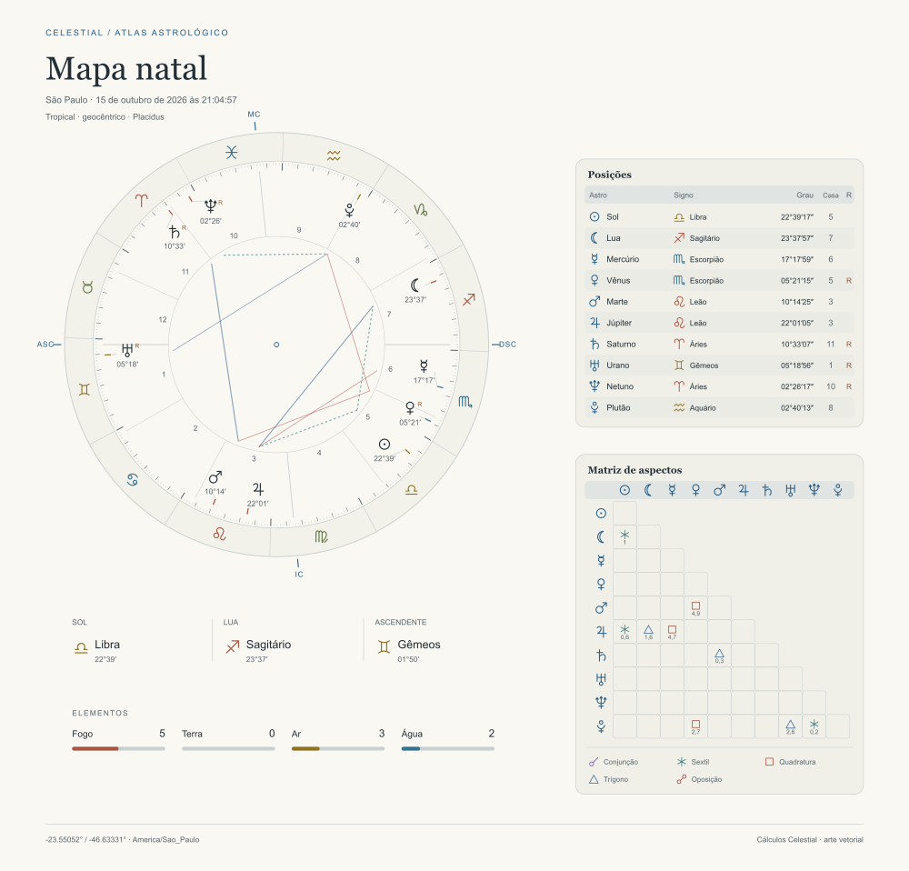
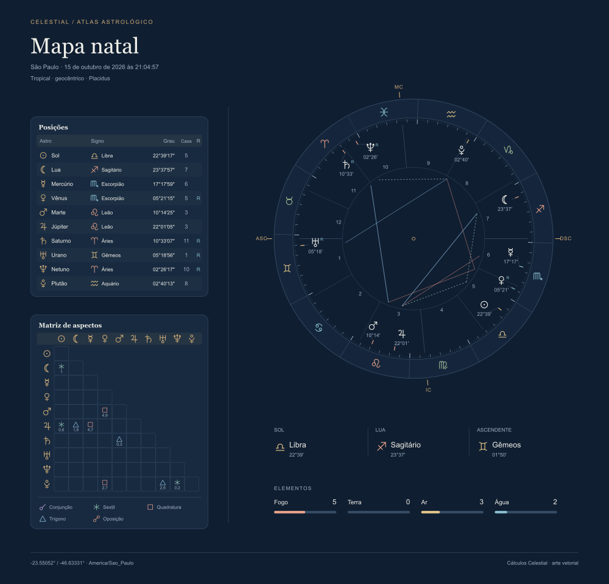
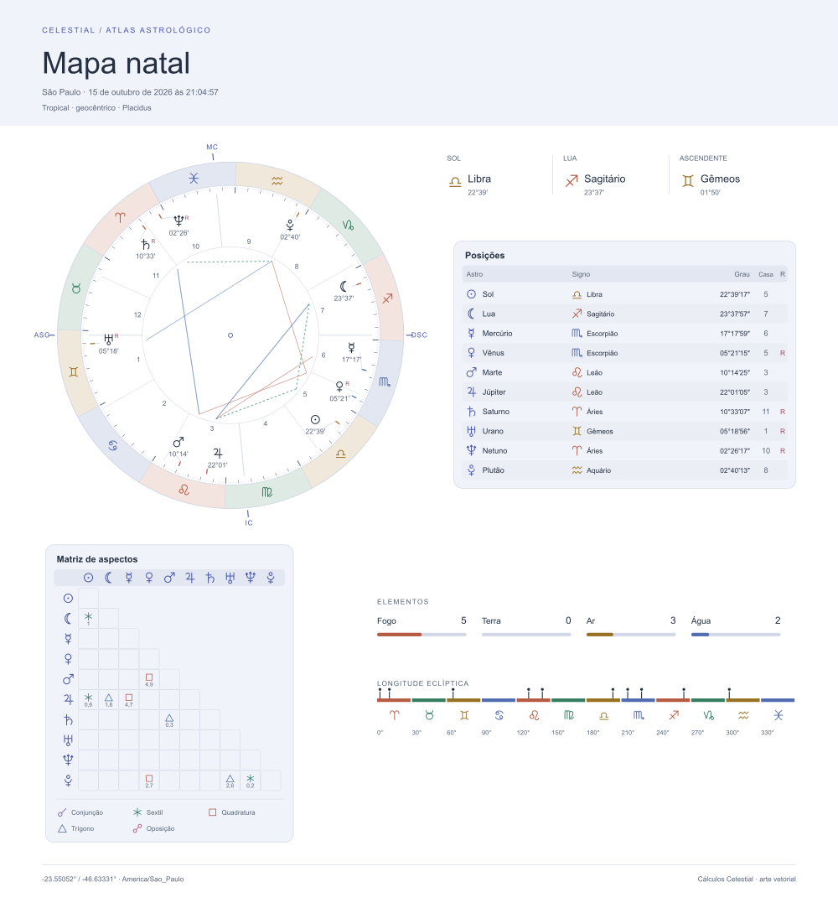

# Celestial WASM

Baseada na biblioteca original [Celestial](https://github.com/geraldo-netto/celestial),
criada por [geraldo-netto](https://github.com/geraldo-netto). Agradecemos ao autor por
disponibilizar o motor de efemérides que fundamenta esta versão em WebAssembly e
sua camada de gráficos TypeScript.

Biblioteca de efemérides em Rust/WebAssembly com bindings TypeScript completos e
geração de mapas astrológicos e tabelas em SVG. Funciona em Node.js e em workers
de módulo do navegador. O runtime não depende de DOM, canvas, N-API ou pacotes
JavaScript externos.

Este diretório é a raiz independente da biblioteca: código, configurações,
scripts, lockfiles, testes, documentação e licença estão contidos nele. Pode ser
copiado para um repositório próprio sem arquivos do diretório pai.

- `celestial-wasm`: motor WASM, 300 funções públicas do core, três aliases e
  bindings dos 69 métodos/builders públicos.
- `celestial-wasm/charts`: cálculo de mapas natais e planetários geocêntricos,
  seis temas, paletas light/dark/personalizadas e componentes SVG independentes.
- `celestial-wasm/wasm`: arquivo binário para resolução explícita de URL ou bytes.

## Instalar a partir do código-fonte

Requisitos de desenvolvimento: **Node.js 24 ou posterior**, npm, Python 3, Rust
via rustup e o CLI wasm-bindgen. O arquivo `rust-toolchain.toml` seleciona Rust
**1.96.0** e o target `wasm32-unknown-unknown`; o CLI precisa corresponder à versão
**0.2.129** fixada no core WASM.

Execute todos os comandos dentro deste diretório, independentemente de onde ele
tenha sido copiado:

```sh
cd celestial
npm ci
cargo install wasm-bindgen-cli --version 0.2.129 --locked
npm run build
npm test
```

`npm ci` instala somente ferramentas de desenvolvimento, com versões fixadas em
`package-lock.json`. `npm run build` gera JavaScript, WebAssembly, declarações
TypeScript e a camada de gráficos em `pkg/`. O core mantém seu `Cargo.lock`.

## Instalar em uma aplicação

A distribuição ainda não foi publicada em um registro. Gere um pacote local:

```sh
# Dentro da biblioteca; prepack executa o build.
npm pack

# Dentro da aplicação consumidora, use o caminho real do arquivo gerado.
npm install /caminho/celestial/celestial-wasm-0.2.0.tgz
```

O consumidor recebe artefatos compilados e tipos; não precisa de Rust ou Python
para executá-los. O pacote inclui a licença e as fontes correspondentes. O
tarball leva o lock npm como `npm-shrinkwrap.json`, pois npm não inclui
`package-lock.json` em arquivos de distribuição. A publicação no registro não
faz parte desses comandos; `private: true` evita publicação acidental.

## Uso rápido no navegador ou em worker

```ts
import init, * as core from 'celestial-wasm';
import {
  createChartCalculator,
  renderChartSvg,
  renderWheelSvg,
  renderPositionsSvg,
} from 'celestial-wasm/charts';

await init();
const calculator = createChartCalculator(core);

const natal = calculator.natal({
  date: '2026-10-15',
  time: '21:04:57',
  timeZone: 'America/Sao_Paulo',
  location: { label: 'São Paulo', latitude: -23.55052, longitude: -46.633308 },
  houseSystem: 'P',
});

const complete = renderChartSvg(natal, { theme: 'botanical', colors: 'dark' });
const wheel = renderWheelSvg(natal, { theme: 'editorial' }); // light por padrão
const positions = renderPositionsSvg(natal, { theme: 'prism', colors: 'light' });

// Em um worker: envie as strings e os dados para a aplicação.
postMessage({ complete, wheel, positions, data: natal });
```

`init()` procura `celestial_wasm_bg.wasm` ao lado do JavaScript gerado. Configure
o empacotador para preservar/copiar esse arquivo ou passe a URL pública dos
bytes explicitamente: `await init({ module_or_path: wasmUrl })`. O export
`celestial-wasm/wasm` permite que o empacotador resolva o asset conforme sua própria
convenção. O servidor deve servir `.wasm` como `application/wasm`.

Inicialize uma vez por worker. O calculator usa uma instância dedicada do motor:
seleciona ΔT automático antes de cada cálculo, sem restaurar overrides anteriores.
As chamadas de cálculo e renderização são síncronas depois da inicialização.

Para obter apenas posições planetárias geocêntricas, sem casas nem localização:

```ts
const sky = calculator.planetary({
  instant: '2026-10-16T00:04:57Z',
  timeZone: 'America/Sao_Paulo',
});
const svg = renderChartSvg(sky, { theme: 'atlas' });
```

Um instante ISO exige `Z` ou offset explícito. Data/hora local exige fuso IANA.
Horas inexistentes ou ambíguas durante mudanças de horário são rejeitadas; um
instante com offset explícito permite escolher a ocorrência desejada. Coordenadas
não são usadas para descobrir automaticamente o fuso.

## Uso em Node.js

```ts
import { readFile, writeFile } from 'node:fs/promises';
import init, * as core from 'celestial-wasm';
import { createChartCalculator, renderChartSvg } from 'celestial-wasm/charts';

await init({
  module_or_path: await readFile(new URL(import.meta.resolve('celestial-wasm/wasm'))),
});
const sky = createChartCalculator(core).planetary({ instant: '2026-10-16T00:04:57Z' });
await writeFile('mapa.svg', renderChartSvg(sky, { theme: 'minimal', colors: 'dark' }));
```

## Temas, cores e transparência

[](charts/examples/gallery/index.html)
[](charts/examples/gallery/index.html)
[](charts/examples/gallery/index.html)

Veja o [catálogo visual completo](docs/themes.md): os seis temas em light e dark,
com mapas natais, planetários e cada roda/tabela individual, gerados pela biblioteca.

Os mesmos parâmetros `theme` e `colors` funcionam no mapa completo, na roda, nas
tabelas e nos componentes individuais.

| Nome exibido | Valor de `theme` |
| --- | --- |
| Editorial | `editorial` |
| Observatório | `midnight` |
| Botânico | `botanical` |
| Prisma | `prism` |
| Atlas | `atlas` |
| Essencial | `minimal` |

`theme` tem padrão `editorial`. `colors` aceita `light` (padrão em **todos** os
temas), `dark` ou uma estrutura completa `ThemeColors`. O nome do tema seleciona
a composição; a estrutura de cores seleciona sua aparência.

```ts
import { getTheme, renderChartSvg, type ThemeColors } from 'celestial-wasm/charts';

const colors: ThemeColors = getTheme('botanical', 'dark').colors;
colors.accent = '#f0c879';
colors.foreground = '#f3f4ef';
colors.surface = 'transparent';
colors.elements = ['#eeb29a', '#aad6a0', '#e3cf89', '#92cbd8'];

const customized = renderChartSvg(natal, { theme: 'botanical', colors });
```

Todos os SVGs têm **fundo transparente**, inclusive as partes que antes usavam a
cor de fundo do tema. `ThemeColors.background` é apenas uma recomendação de cor
para o elemento HTML hospedeiro; nunca é pintada no SVG. Você pode trocar o fundo
da página sem regenerar o desenho. Escolha light para páginas claras e dark para
páginas escuras para manter a leitura.

Superfícies de tabelas, faixas e setores são partes do desenho e mantêm suas cores.
Para remover o preenchimento das superfícies, use `surface: 'transparent'`.
O contrato completo, cada campo da paleta e formatos de cor aceitos estão no
[guia de mapas, temas e estruturas](charts/README.md).

## SVG completo ou componentes independentes

| Função | Saída |
| --- | --- |
| `renderChartSvg` | Composição completa do tema |
| `renderWheelSvg` | Roda independente |
| `renderTablesSvg` | Conjunto das tabelas |
| `renderPositionsSvg` | Tabela de posições |
| `renderHousesSvg` | Tabela de casas; `undefined` no planetário |
| `renderAspectMatrixSvg` | Matriz de aspectos |
| `renderAspectsSvg` | Lista de aspectos com orbe e fase |
| `renderChartBundle` | Todos os SVGs acima em um objeto |

Os glifos astrológicos são caminhos vetoriais próprios. Textos usam fontes de
sistema. A API também expõe fragmentos `<g>` para montar uma composição própria,
com posição e largura configuráveis. Consulte os tipos e exemplos no guia de
charts. Rótulos podem se afastar para evitar colisões; os marcadores dos astros e
os extremos das linhas de aspectos continuam nas longitudes calculadas.

## Documentação e comandos

- [Guia de mapas, funções, temas, paletas, dados e erros](charts/README.md).
- [Referência completa gerada das APIs TypeScript](docs/api-reference.md).
- [Contratos do binding WASM](wasm/README.md).
- [Arquitetura](docs/architecture.md), [portabilidade e baseline dos testes](docs/portability.md).
- [Origem e avisos da distribuição](NOTICE), [licença](LICENSE), [limites herdados](TODO.md).
- [Galeria de SVGs reais](charts/examples/gallery/index.html), regenerável após copiar a biblioteca.

| Comando | Ação |
| --- | --- |
| `npm run build` | Compila Rust/WASM, bindings e charts |
| `npm run build:charts` | Recompila somente TypeScript, após existir o build WASM |
| `npm test` | Core WASM, bindings, gráficos, referência API e avisos de licença |
| `npm run test:core` | Testes unitários, integração e Rustdoc em WASM |
| `npm run test:bindings` | Build e testes TypeScript sobre o WASM real |
| `npm run test:charts` | Build, tipos, testes SVG/worker e mutações dirigidas |
| `npm run gallery` | Gera SVGs, galeria interativa e catálogo visual de todos os componentes |
| `npm run docs` | Regenera a referência a partir das declarações compiladas |
| `npm run docs:check` | Detecta referência API desatualizada |
| `npm run licenses` | Regenera avisos das dependências Rust usadas no build WASM |
| `npm run licenses:check` | Detecta avisos de dependências desatualizados |
| `npm pack` | Gera tarball instalável, compilando antes |

A galeria usa o instante fixo `2026-10-16T00:04:57Z`, correspondente a
15/10/2026 às 21:04:57 em São Paulo, para facilitar comparações reproduzíveis.
Seus SVGs permanecem transparentes; somente as prévias PNG recebem uma cor de
página. `sharp` é usado apenas no desenvolvimento para inspecionar os SVGs.

## Licença e origem

Esta distribuição mantém **AGPL-3.0-or-later**, conforme os manifests do projeto
original [Celestial](https://github.com/geraldo-netto/celestial), de `geraldo-netto`,
na revisão `0e2bb383bc7b1b20112bd9ef6b01e7548bf09eb2`. A mesma licença cobre as
adaptações WASM e a camada TypeScript desta distribuição. O texto GNU AGPL v3 está
preservado integralmente em [LICENSE](LICENSE); [NOTICE](NOTICE) registra origem,
autoria, revisão e alterações. O [README original](UPSTREAM-README.md) também
foi preservado. As dependências mantêm suas próprias licenças, com textos e avisos
em [THIRD-PARTY-NOTICES.txt](THIRD-PARTY-NOTICES.txt).

O motor usa efemérides embutidas e conserva as aproximações do core original.
Os testes de regressão não demonstram equivalência de precisão com Swiss
Ephemeris/JPL. A biblioteca não gera interpretações astrológicas em texto.
