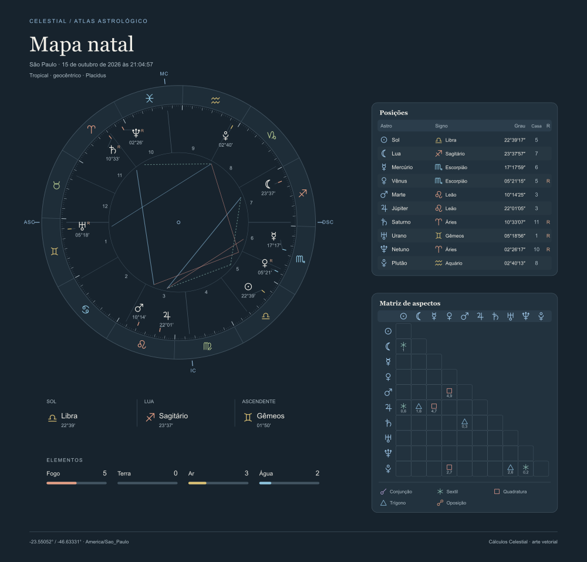

<!-- Gerado por npm run gallery. -->
# Catálogo visual: temas e componentes

Baseado na biblioteca original [Celestial](https://github.com/geraldo-netto/celestial), de [geraldo-netto](https://github.com/geraldo-netto). Agradecemos ao autor por disponibilizar o motor de efemérides que fundamenta esta distribuição.

Prévias reais calculadas pelo WASM para São Paulo em 15/10/2026 às 21:04:57 (16/10/2026 às 00:04:57 UTC). Os PNGs mostram cada SVG transparente sobre o fundo recomendado da paleta; a cor de página não faz parte do SVG exportado.

Cada tema tem light (padrão), dark e suporte a cores personalizadas. Abra o catálogo do tema para comparar **todos os componentes individualmente**, nos mapas natal e planetário: roda, posições, casas (somente natal), matriz de aspectos, lista de aspectos e conjunto de tabelas.

[Guia da API e paletas](../charts/README.md) · [Galeria interativa com seleção de componente e fundo](../charts/examples/gallery/index.html)

## Editorial

Azul mineral e uma composição de revista.

[Ver mapa e todos os componentes de Editorial](themes/editorial.md)

| Light | Dark |
| --- | --- |
|  |  |

## Observatório

Azul, cobre e uma roda ampla como protagonista.

[Ver mapa e todos os componentes de Observatório](themes/midnight.md)

| Light | Dark |
| --- | --- |
|  |  |

## Botânico

Verde floresta, argila e tabelas de leitura tranquila.

[Ver mapa e todos os componentes de Botânico](themes/botanical.md)

| Light | Dark |
| --- | --- |
|  |  |

## Prisma

Cor por elemento, geometria precisa e painéis organizados.

[Ver mapa e todos os componentes de Prisma](themes/prism.md)

| Light | Dark |
| --- | --- |
|  |  |

## Atlas

Instrumento celeste em azul, com régua zodiacal e dados técnicos.

[Ver mapa e todos os componentes de Atlas](themes/atlas.md)

| Light | Dark |
| --- | --- |
|  |  |

## Essencial

Muito espaço, traços delicados e poucos acentos de cor.

[Ver mapa e todos os componentes de Essencial](themes/minimal.md)

| Light | Dark |
| --- | --- |
|  |  |

