<!-- Gerado por npm run gallery. -->
# Editorial: mapas e componentes

Baseado na biblioteca original [Celestial](https://github.com/geraldo-netto/celestial), de [geraldo-netto](https://github.com/geraldo-netto). Agradecemos ao autor por disponibilizar o motor de efemérides que fundamenta esta distribuição.

[Todos os temas](../themes.md) · [Guia de funções e paletas](../../charts/README.md) · [Galeria interativa](../../charts/examples/gallery/index.html)

Tema: `editorial`. Cores: `light` (padrão), `dark` ou `ThemeColors`. Prévias geradas da biblioteca, sem reproduzir cálculos no desenho. Fundo externo composto apenas para leitura nesta documentação; os links SVG mantêm transparência.

## Composição completa — natal · São Paulo · Placidus

`renderChartSvg(data, { theme: 'editorial', colors: 'light' })`

Troque `colors` por `'dark'` ou sua paleta.

| Light | Dark |
| --- | --- |
|  [SVG transparente](../../charts/examples/gallery/editorial-light-natal-chart.svg) |  [SVG transparente](../../charts/examples/gallery/editorial-dark-natal-chart.svg) |

## Composição completa — planetário · geocêntrico · sem casas

`renderChartSvg(data, { theme: 'editorial', colors: 'light' })`

Troque `colors` por `'dark'` ou sua paleta.

| Light | Dark |
| --- | --- |
| [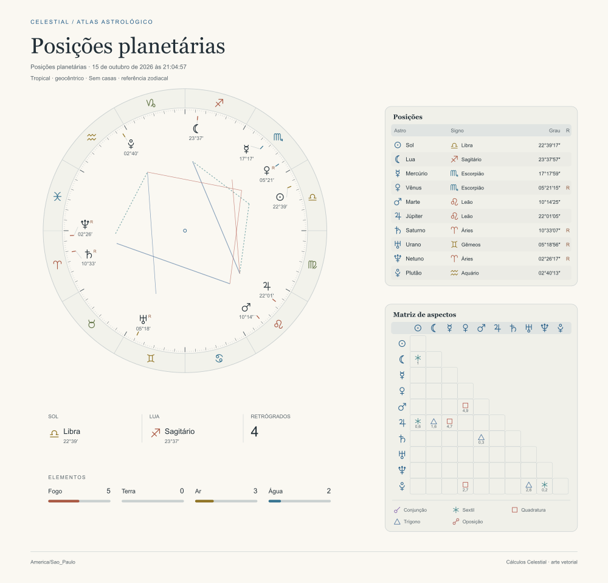](../images/editorial-light-planetary-chart.png) [SVG transparente](../../charts/examples/gallery/editorial-light-planetary-chart.svg) | [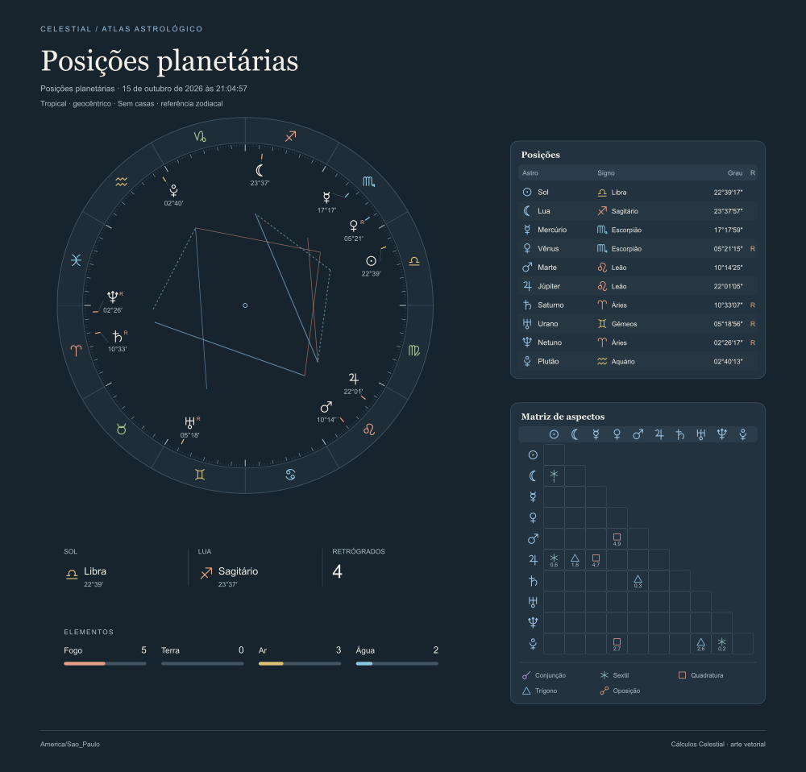](../images/editorial-dark-planetary-chart.png) [SVG transparente](../../charts/examples/gallery/editorial-dark-planetary-chart.svg) |

## Roda — natal · São Paulo · Placidus

`renderWheelSvg(data, { theme: 'editorial', colors: 'light' })`

Troque `colors` por `'dark'` ou sua paleta.

| Light | Dark |
| --- | --- |
| [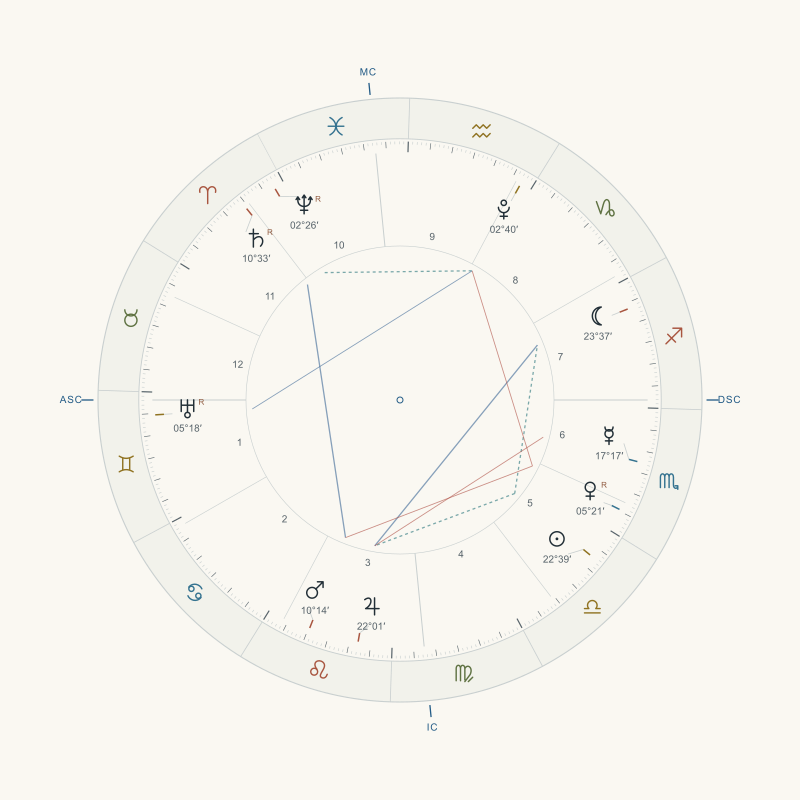](../images/editorial-light-natal-wheel.png) [SVG transparente](../../charts/examples/gallery/editorial-light-natal-wheel.svg) | [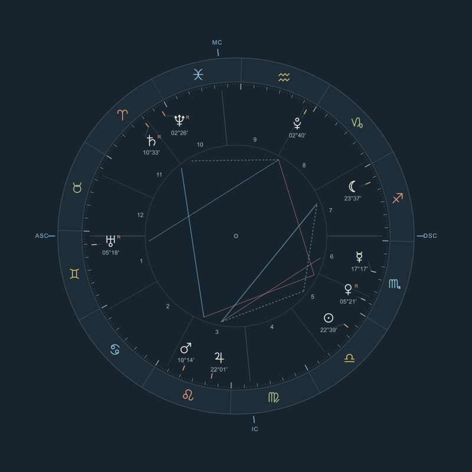](../images/editorial-dark-natal-wheel.png) [SVG transparente](../../charts/examples/gallery/editorial-dark-natal-wheel.svg) |

## Roda — planetário · geocêntrico · sem casas

`renderWheelSvg(data, { theme: 'editorial', colors: 'light' })`

Troque `colors` por `'dark'` ou sua paleta.

| Light | Dark |
| --- | --- |
| [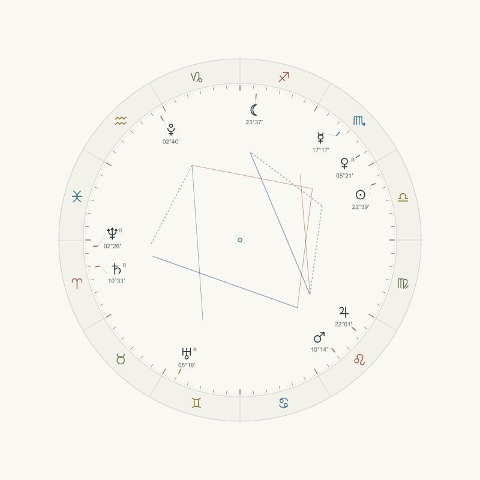](../images/editorial-light-planetary-wheel.png) [SVG transparente](../../charts/examples/gallery/editorial-light-planetary-wheel.svg) | [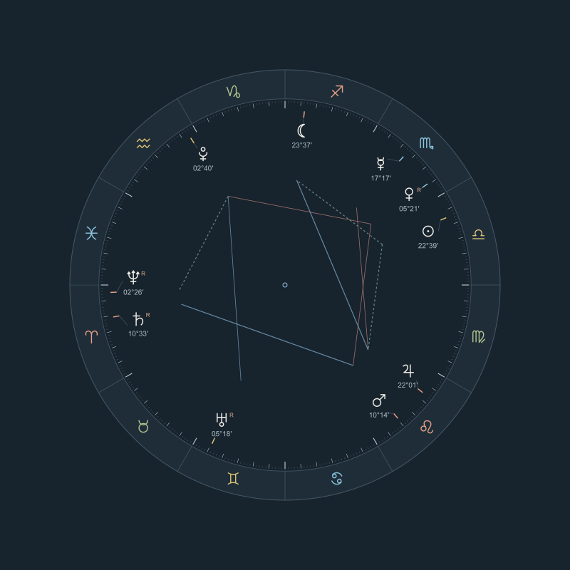](../images/editorial-dark-planetary-wheel.png) [SVG transparente](../../charts/examples/gallery/editorial-dark-planetary-wheel.svg) |

## Posições — natal · São Paulo · Placidus

`renderPositionsSvg(data, { theme: 'editorial', colors: 'light' })`

Troque `colors` por `'dark'` ou sua paleta.

| Light | Dark |
| --- | --- |
| [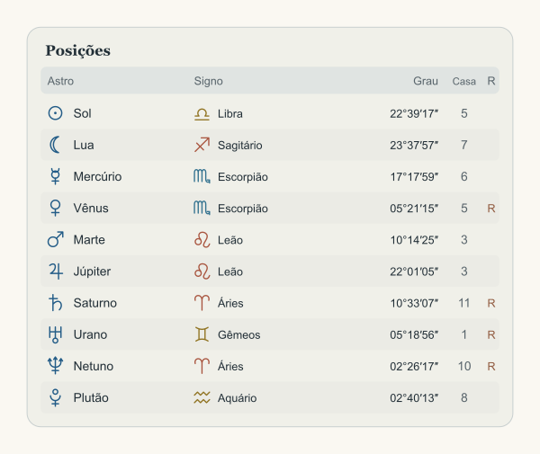](../images/editorial-light-natal-positions.png) [SVG transparente](../../charts/examples/gallery/editorial-light-natal-positions.svg) | [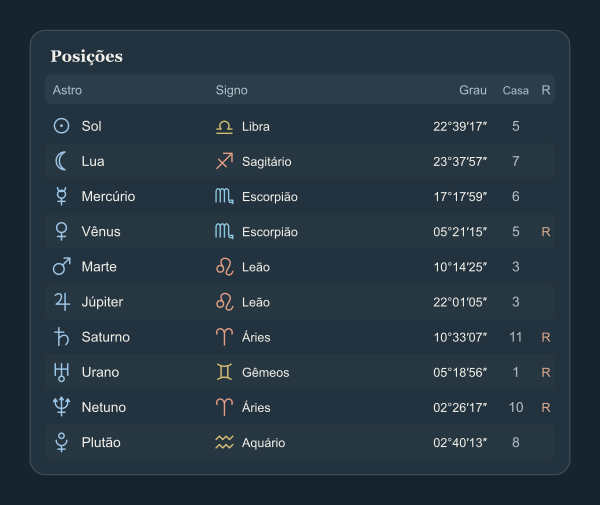](../images/editorial-dark-natal-positions.png) [SVG transparente](../../charts/examples/gallery/editorial-dark-natal-positions.svg) |

## Posições — planetário · geocêntrico · sem casas

`renderPositionsSvg(data, { theme: 'editorial', colors: 'light' })`

Troque `colors` por `'dark'` ou sua paleta.

| Light | Dark |
| --- | --- |
| [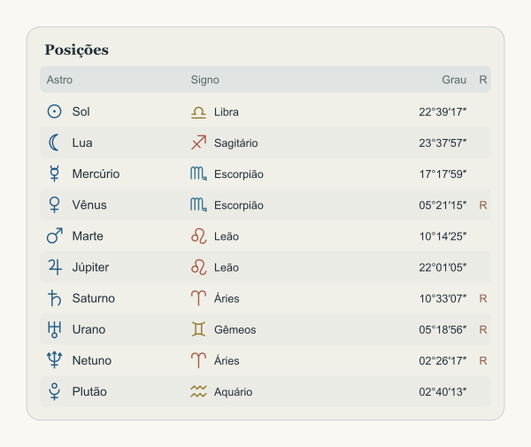](../images/editorial-light-planetary-positions.png) [SVG transparente](../../charts/examples/gallery/editorial-light-planetary-positions.svg) | [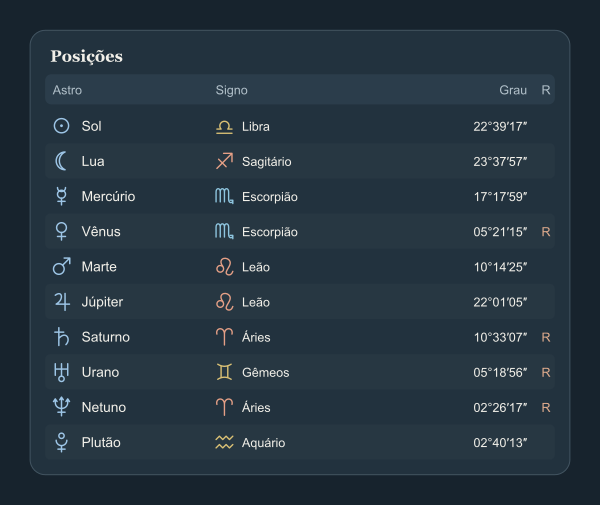](../images/editorial-dark-planetary-positions.png) [SVG transparente](../../charts/examples/gallery/editorial-dark-planetary-positions.svg) |

## Casas — natal · São Paulo · Placidus

`renderHousesSvg(data, { theme: 'editorial', colors: 'light' })`

Troque `colors` por `'dark'` ou sua paleta.

| Light | Dark |
| --- | --- |
| [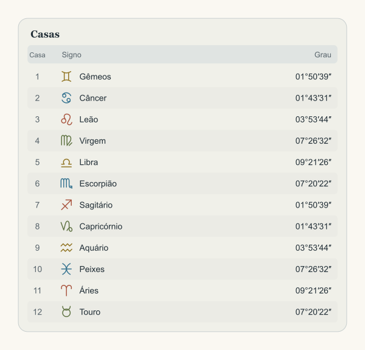](../images/editorial-light-natal-houses.png) [SVG transparente](../../charts/examples/gallery/editorial-light-natal-houses.svg) | [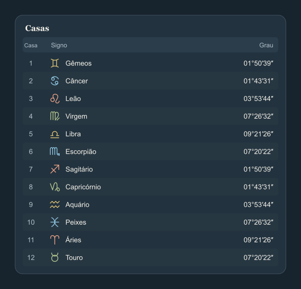](../images/editorial-dark-natal-houses.png) [SVG transparente](../../charts/examples/gallery/editorial-dark-natal-houses.svg) |

## Matriz de aspectos — natal · São Paulo · Placidus

`renderAspectMatrixSvg(data, { theme: 'editorial', colors: 'light' })`

Troque `colors` por `'dark'` ou sua paleta.

| Light | Dark |
| --- | --- |
| [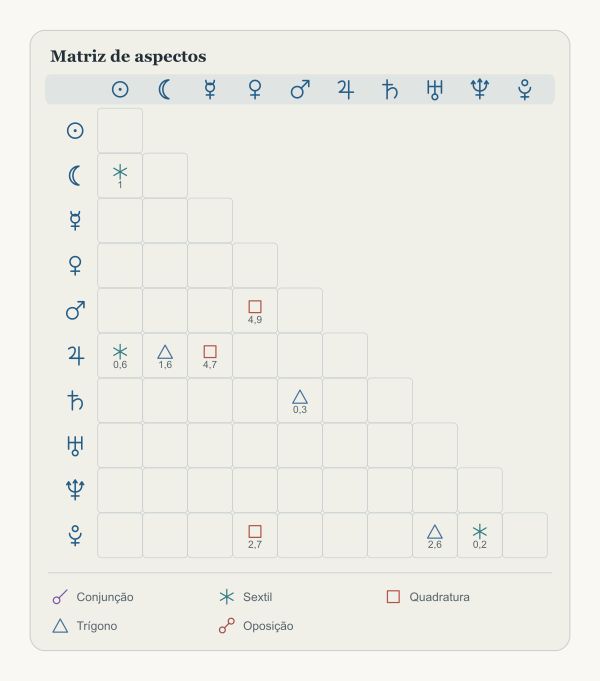](../images/editorial-light-natal-aspects.png) [SVG transparente](../../charts/examples/gallery/editorial-light-natal-aspects.svg) | [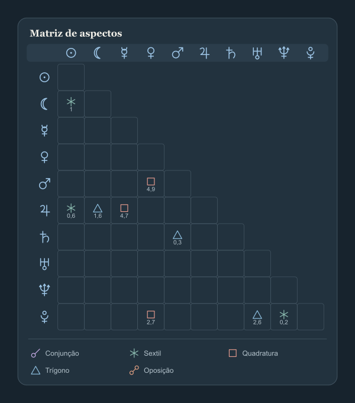](../images/editorial-dark-natal-aspects.png) [SVG transparente](../../charts/examples/gallery/editorial-dark-natal-aspects.svg) |

## Matriz de aspectos — planetário · geocêntrico · sem casas

`renderAspectMatrixSvg(data, { theme: 'editorial', colors: 'light' })`

Troque `colors` por `'dark'` ou sua paleta.

| Light | Dark |
| --- | --- |
|  [SVG transparente](../../charts/examples/gallery/editorial-light-planetary-aspects.svg) |  [SVG transparente](../../charts/examples/gallery/editorial-dark-planetary-aspects.svg) |

## Lista de aspectos — natal · São Paulo · Placidus

`renderAspectsSvg(data, { theme: 'editorial', colors: 'light' })`

Troque `colors` por `'dark'` ou sua paleta.

| Light | Dark |
| --- | --- |
| [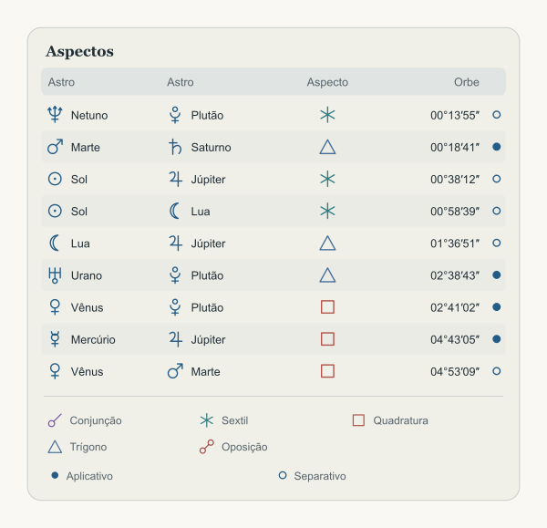](../images/editorial-light-natal-aspectList.png) [SVG transparente](../../charts/examples/gallery/editorial-light-natal-aspectList.svg) |  [SVG transparente](../../charts/examples/gallery/editorial-dark-natal-aspectList.svg) |

## Lista de aspectos — planetário · geocêntrico · sem casas

`renderAspectsSvg(data, { theme: 'editorial', colors: 'light' })`

Troque `colors` por `'dark'` ou sua paleta.

| Light | Dark |
| --- | --- |
|  [SVG transparente](../../charts/examples/gallery/editorial-light-planetary-aspectList.svg) | [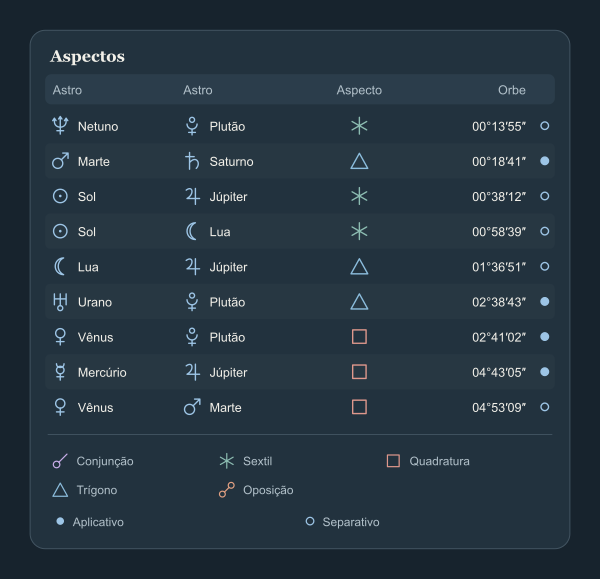](../images/editorial-dark-planetary-aspectList.png) [SVG transparente](../../charts/examples/gallery/editorial-dark-planetary-aspectList.svg) |

## Conjunto de tabelas — natal · São Paulo · Placidus

`renderTablesSvg(data, { theme: 'editorial', colors: 'light' })`

Troque `colors` por `'dark'` ou sua paleta.

| Light | Dark |
| --- | --- |
| [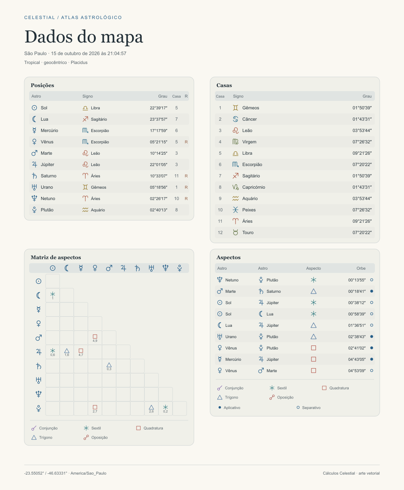](../images/editorial-light-natal-tables.png) [SVG transparente](../../charts/examples/gallery/editorial-light-natal-tables.svg) | [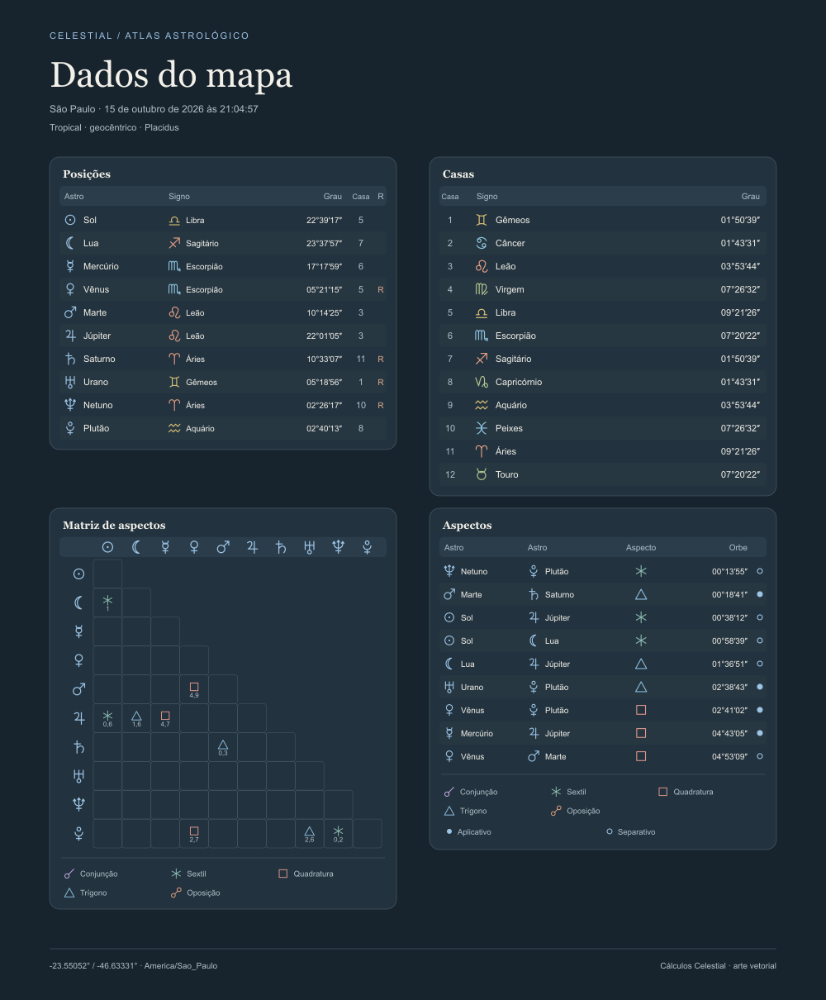](../images/editorial-dark-natal-tables.png) [SVG transparente](../../charts/examples/gallery/editorial-dark-natal-tables.svg) |

## Conjunto de tabelas — planetário · geocêntrico · sem casas

`renderTablesSvg(data, { theme: 'editorial', colors: 'light' })`

Troque `colors` por `'dark'` ou sua paleta.

| Light | Dark |
| --- | --- |
| [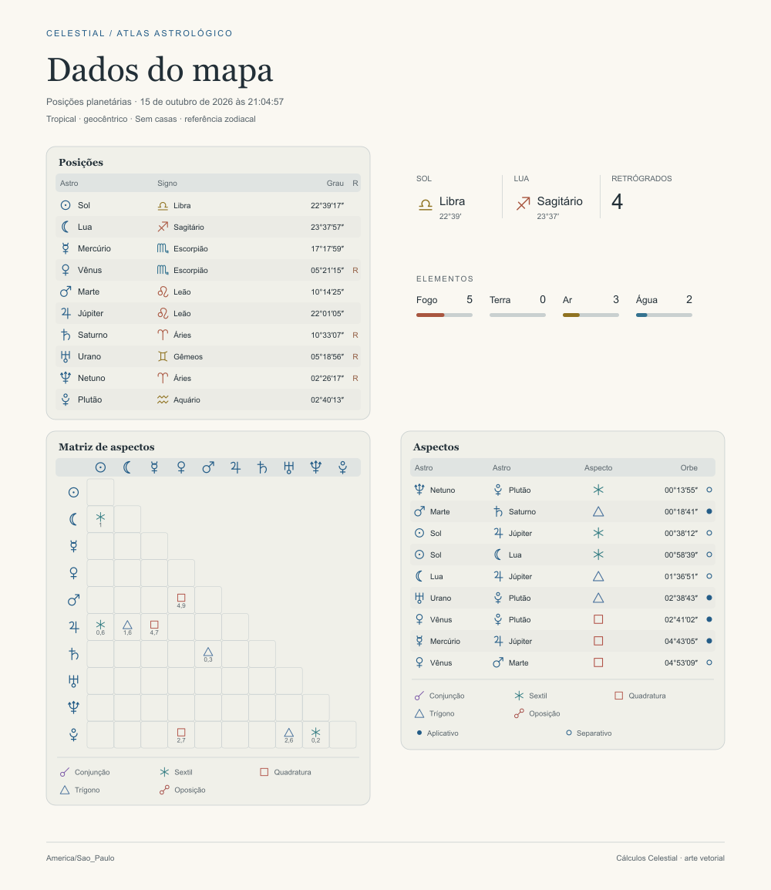](../images/editorial-light-planetary-tables.png) [SVG transparente](../../charts/examples/gallery/editorial-light-planetary-tables.svg) | [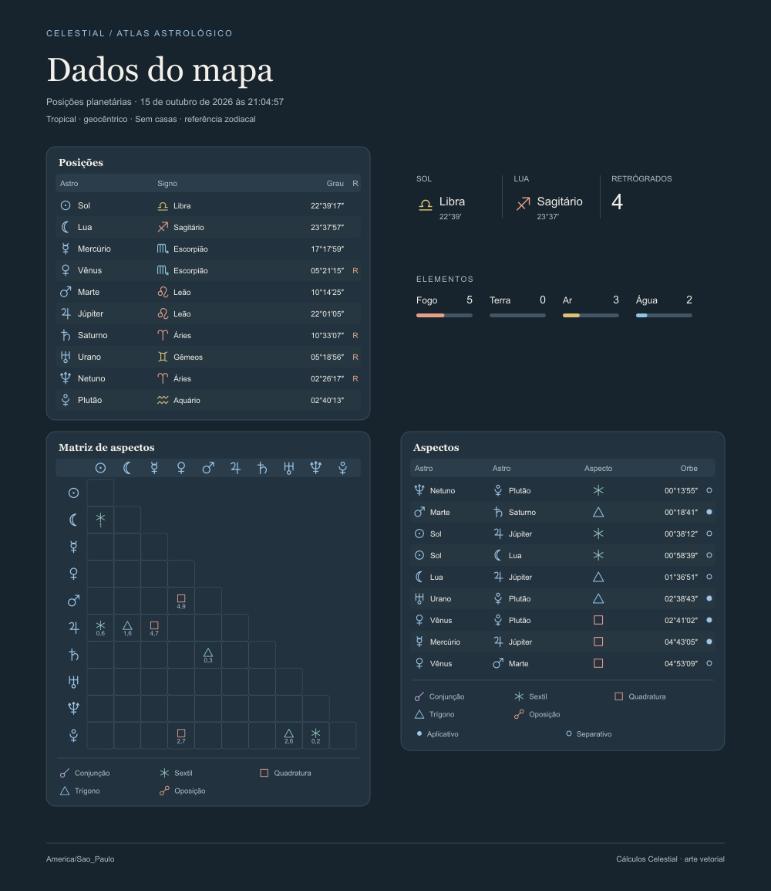](../images/editorial-dark-planetary-tables.png) [SVG transparente](../../charts/examples/gallery/editorial-dark-planetary-tables.svg) |

